# NetSphere — Entity Relationship Diagram

Tables actually created by Phase 1 migrations are marked ✅. Everything else
in the original 30+ entity list is named here (so the schema has a stable
home to grow into) but not yet migrated — marked ⏳ with the phase that adds
it. Adding a ⏳ table later is a new Alembic revision, never a hand-edit of
an old one.

```mermaid
erDiagram
    ORGANIZATION ||--o{ BUSINESS_UNIT : contains
    BUSINESS_UNIT ||--o{ ENVIRONMENT : contains
    ENVIRONMENT ||--o{ CLOUD_ACCOUNT : contains
    CLOUD_ACCOUNT ||--o{ NETWORK : contains
    NETWORK ||--o{ SUBNET : contains
    SUBNET ||--o{ IP_ADDRESS : contains
    NETWORK }o--o| NETWORK : "parent_network (VPC/VNet hierarchy)"

    ROLE ||--o{ ROLE_PERMISSION : has
    PERMISSION ||--o{ ROLE_PERMISSION : "granted via"
    USER ||--o{ USER_ROLE : has
    ROLE ||--o{ USER_ROLE : "assigned via"

    USER ||--o{ AUDIT_LOG : performs

    ENVIRONMENT ||--o{ DEVICE : contains
    DEVICE ||--o{ INTERFACE : has
    INTERFACE }o--o| SUBNET : "cross-linked when its IP falls inside a known subnet"

    ORGANIZATION {
        uuid id PK
        string name
        timestamptz created_at
        timestamptz updated_at
        timestamptz deleted_at "soft delete"
    }
    BUSINESS_UNIT {
        uuid id PK
        uuid organization_id FK
        string name
        timestamptz created_at
        timestamptz updated_at
    }
    ENVIRONMENT {
        uuid id PK
        uuid business_unit_id FK
        string name "prod | staging | dev | ..."
        timestamptz created_at
    }
    CLOUD_ACCOUNT {
        uuid id PK
        uuid environment_id FK
        string provider "aws|azure|gcp|oci|onprem"
        string account_identifier "account/subscription/project/tenancy id"
        string credential_ref "pointer only, never a secret"
        string region_default
        string status "active|disabled"
        timestamptz created_at
    }
    NETWORK {
        uuid id PK
        uuid cloud_account_id FK
        uuid parent_network_id FK "nullable, self-ref for VPC->subnet-of-subnet style nesting"
        string name
        string cidr
        bigint network_addr "uint32, indexed"
        bigint broadcast_addr "uint32, indexed"
        int prefix_len
        string provider "denormalized for query speed"
        string region
        string owner_team
        string business_unit_name "denormalized label"
        string environment_name "denormalized label"
        string vrf
        string vlan
        string status "active|deprecated|planned"
        text notes
        timestamptz created_at
        timestamptz updated_at
        timestamptz deleted_at
    }
    SUBNET {
        uuid id PK
        uuid network_id FK
        string name
        string cidr
        bigint network_addr
        bigint broadcast_addr
        int prefix_len
        string availability_zone
        string owner_team
        string application
        string status
        timestamptz created_at
        timestamptz updated_at
    }
    IP_ADDRESS {
        uuid id PK
        uuid subnet_id FK
        string ip_address
        bigint ip_int "uint32, indexed"
        string status "allocated|reserved|free"
        string assigned_to
        string hostname
        text notes
        timestamptz created_at
        timestamptz updated_at
    }

    USER {
        uuid id PK
        string email UK
        string full_name
        string hashed_password
        bool is_active
        timestamptz created_at
    }
    ROLE {
        uuid id PK
        string name UK "SUPER_ADMIN | NETWORK_ADMIN | ..."
        string description
    }
    PERMISSION {
        uuid id PK
        string code UK "ipam:read | ipam:write | ..."
        string description
    }
    ROLE_PERMISSION {
        uuid role_id FK
        uuid permission_id FK
    }
    USER_ROLE {
        uuid user_id FK
        uuid role_id FK
    }
    AUDIT_LOG {
        uuid id PK
        uuid user_id FK
        string action
        string resource_type
        string resource_id
        jsonb before
        jsonb after
        string request_id
        string result "success|failure"
        string source_ip
        timestamptz created_at
    }
    DEVICE {
        uuid id PK
        uuid environment_id FK
        string hostname "indexed"
        string vendor "cisco|juniper|paloalto|fortinet|generic|... nullable"
        string device_type "router|switch|firewall|load_balancer|other"
        string mgmt_ip
        string site
        string source "manual|snmp"
        string external_id "provider-native id when source=snmp"
        string status "active|disabled"
        text notes
        timestamptz created_at
        timestamptz updated_at
        timestamptz deleted_at
    }
    INTERFACE {
        uuid id PK
        uuid device_id FK
        uuid subnet_id FK "nullable, set by the discovery cross-link, not enforced"
        string name "e.g. GigabitEthernet0/1"
        string description
        string ip_address
        string mac_address
        string admin_status "up|down"
        string oper_status "up|down"
        int speed_mbps
        int vlan_id
        timestamptz created_at
        timestamptz updated_at
    }

    USER ||--o{ POA_REFERENCE_FILE : uploads
    USER ||--o{ POA_RUN : creates

    POA_REFERENCE_FILE {
        uuid id PK
        string kind "unique — one of POA_REFERENCE_KINDS, see app/models/poa.py"
        string filename
        bytes content "LargeBinary — the uploaded inventory sheet itself"
        int size_bytes
        uuid uploaded_by_id FK "nullable"
        timestamptz created_at
        timestamptz updated_at
    }
    POA_RUN {
        uuid id PK
        string ritm_number "indexed"
        string input_filename
        int row_count
        int manual_count
        int invalid_count
        jsonb warnings "list[str]"
        jsonb rows "the enriched row set — one dict per RITM input row"
        jsonb metadata_json "run metadata — same shape as the original tool's config.json"
        bytes excel_content "LargeBinary — the generated .xlsx"
        bytes docx_content "LargeBinary — the generated .docx"
        uuid created_by_id FK "nullable"
        timestamptz created_at
        timestamptz updated_at
    }

    NETWORK ||--o{ ROUTE_TABLE : has
    ROUTE_TABLE ||--o{ ROUTE : contains
    DEVICE ||--o{ ROUTE : "holds static routes"
    SUBNET }o--o| ROUTE_TABLE : "cross-linked when its association is known"

    SUBNET ||--o{ CLOUD_NETWORK_INTERFACE : has
    NETWORK }o--o{ NETWORK_PEERING : "peers via (network_a/network_b)"
    NETWORK ||--o{ SECURITY_GROUP : has
    SECURITY_GROUP ||--o{ SECURITY_RULE : contains
    FIREWALL_INTEGRATION ||--o{ FW_INTENT : "targets (target_kind=firewall)"
    SECURITY_GROUP ||--o{ FW_INTENT : "targets (target_kind=cloud provider)"
    SECURITY_POLICY_BATCH ||--o{ FW_INTENT : "created (RITM intake)"

    SECURITY_GROUP {
        uuid id PK
        uuid network_id FK
        uuid cloud_account_id FK
        string provider "azure_nsg|aws_sg|gcp_firewall|oci_security_list"
        string name
        string description
        string source "manual|discovered|auto"
        string external_id "nullable"
        timestamptz created_at
        timestamptz updated_at
        timestamptz deleted_at "nullable"
    }

    SECURITY_RULE {
        uuid id PK
        uuid security_group_id FK
        string direction "inbound|outbound"
        int priority "nullable — azure_nsg/gcp_firewall"
        string action "allow|deny"
        string protocol
        int port_low "nullable"
        int port_high "nullable"
        string cidr
        string status "active|disabled"
        string source "manual|discovered|automated"
        bool managed_by_fwauto
        string rule_group_key "nullable"
        string ticket_ref "nullable"
        timestamptz expires_at "nullable"
        jsonb extra_json
    }

    SECURITY_POLICY_BATCH {
        uuid id PK
        string source_filename "nullable"
        string source_format "xlsx|csv|ods"
        string ticket_ref
        int row_count
        int resolved_count
        int unresolved_count
        jsonb unresolved_rows_json
        jsonb parse_warnings_json
        uuid uploaded_by_id FK "nullable"
    }

    CLOUD_NETWORK_INTERFACE {
        uuid id PK
        uuid subnet_id FK
        string name
        string private_ip
        string public_ip
        string attached_to
        string status "in_use|available"
        jsonb security_groups "free-text names, see ROADMAP"
        string source "manual|discovered"
        string external_id "nullable"
        text notes
        timestamptz created_at
        timestamptz updated_at
        timestamptz deleted_at
    }
    NETWORK_PEERING {
        uuid id PK
        uuid network_a_id FK
        uuid network_b_id FK
        string status "active|pending|rejected|expired"
        string source "manual|discovered"
        string external_id "nullable"
        text notes
        timestamptz created_at
        timestamptz updated_at
        timestamptz deleted_at
    }

    ROUTE_TABLE {
        uuid id PK
        uuid network_id FK
        string name
        boolean is_main
        string source "manual|discovered"
        string external_id "nullable, set when source=discovered"
        text notes
        timestamptz created_at
        timestamptz updated_at
        timestamptz deleted_at
    }
    ROUTE {
        uuid id PK
        uuid route_table_id FK "nullable — exactly one of this or device_id is set"
        uuid device_id FK "nullable — exactly one of this or route_table_id is set"
        string destination_cidr
        string target_type "local|internet_gateway|nat_gateway|vpc_peering|transit_gateway|vpn_gateway|virtual_appliance|next_hop|interface|instance|other"
        string target_ref "nullable — the target's own id/name/next-hop-ip"
        string state "active|blackhole"
        string external_id "nullable"
        timestamptz created_at
        timestamptz updated_at
    }

    CLOUD_ACCOUNT ||--o{ CIRCUIT : "owns (cloud side)"
    DEVICE ||--o{ CIRCUIT : "owns (on-prem side)"
    CIRCUIT ||--o{ BGP_SESSION : carries
    CIRCUIT ||--o{ CONNECTIVITY_LINK : attaches
    NETWORK ||--o{ CONNECTIVITY_LINK : "reached via"
    NETWORK ||--o{ VPN_CONNECTION : "backed up by"
    DEVICE ||--o{ VPN_CONNECTION : terminates

    CIRCUIT {
        uuid id PK
        uuid cloud_account_id FK "nullable — exactly one of this or device_id is set"
        uuid device_id FK "nullable — exactly one of this or cloud_account_id is set"
        string circuit_type "direct_connect|expressroute|interconnect|fastconnect|mpls"
        string name
        string vrf "nullable"
        bigint bandwidth_mbps "nullable"
        string location "nullable — the colo/POP name"
        string status "active|provisioning|down|decommissioned"
        string source "manual|discovered"
        string external_id "nullable"
        text notes
        timestamptz created_at
        timestamptz updated_at
        timestamptz deleted_at
    }
    BGP_SESSION {
        uuid id PK
        uuid circuit_id FK
        bigint local_asn
        bigint peer_asn
        string local_ip "nullable"
        string peer_ip "nullable"
        string state "established|idle|down"
        string source "manual|discovered"
        string external_id "nullable"
        timestamptz created_at
        timestamptz updated_at
    }
    CONNECTIVITY_LINK {
        uuid id PK
        uuid network_id FK
        uuid circuit_id FK
        string status "active|pending|down"
        string source "manual|discovered"
        text notes
        timestamptz created_at
        timestamptz updated_at
        timestamptz deleted_at
    }
    VPN_CONNECTION {
        uuid id PK
        uuid network_id FK "nullable — exactly one of this or device_id is set"
        uuid device_id FK "nullable — exactly one of this or network_id is set"
        string peer_ip "nullable"
        string status "up|down|degraded"
        string source "manual|discovered"
        string external_id "nullable"
        text notes
        timestamptz created_at
        timestamptz updated_at
        timestamptz deleted_at
    }
```

`ROUTE_TABLE`/`ROUTE` (migration `781cba56ba2f`) are Phase 3's routing
inventory — one route table per network (a deliberate simplification, see
`app/services/routing.py`), and routes owned by exactly one of a route
table or a device, enforced with a real `CheckConstraint`
(`ck_routes_exactly_one_owner`), not just application-level convention.

`CLOUD_NETWORK_INTERFACE`/`NETWORK_PEERING` (migration `5f8b2e6c1a04`) are
Phase 3's cloud-networks inventory — ENIs/NICs/VNICs discovered per cloud
(the `network_interfaces` table this section previously reserved),
attached to the subnet they ride along with, plus VPC/VNet/VCN peering
connections between networks. A peering's two sides are stored in
canonical (lower-id-first) order with a unique pair constraint, so the
same real-world connection discoverable from either side's account
upserts to one row; self-peering is rejected with a real `CheckConstraint`
(`ck_peerings_distinct_networks`). `security_groups` is free-text JSONB on
this table specifically — see `SECURITY_GROUP`/`SECURITY_RULE` below
(migration `c4f8b2e6d915`) for the normalized object Phase 6 built; this
free-text list itself is left as-is (a one-time backfill into real
`SecurityGroup` rows is a documented follow-up, not done in this delivery).

`CIRCUIT`/`BGP_SESSION`/`CONNECTIVITY_LINK`/`VPN_CONNECTION` (migration
`8a1d4e7f2b96`) are Phase 8's connectivity monitoring quartet this section
previously reserved — the real hybrid network this platform models: each
cloud reaches on-prem over its own dedicated interconnect (AWS Direct
Connect, Azure ExpressRoute, GCP Cloud Interconnect, OCI FastConnect)
riding an MPLS backbone with VRF-based segmentation. A `CIRCUIT` is owned
by exactly one of a `CloudAccount` (the cloud-side end) or a `Device` (the
on-prem-side end) — enforced with a real `CheckConstraint`
(`ck_circuits_exactly_one_owner`), same convention as `Route`'s. The two
ends of one real physical link are independently-discovered `Circuit` rows
rather than one shared row (see `app/models/connectivity.py`'s docstring
for why). `VPN_CONNECTION` follows the identical exactly-one-owner pattern
against a `Network`/`Device` pair
(`ck_vpn_connections_exactly_one_owner`), for IPsec backups that ride the
public internet rather than a physical circuit.

`POA_REFERENCE_FILE`/`POA_RUN` (migration `a1b2c3d4e5f6`) are the
Automation module's Plan-of-Action generator tables — ported from a
standalone RITM-POA tool (see `docs/ROADMAP.md`'s "Just completed:
Automation module" entry). Both store their content as bytes in Postgres
rather than a mounted volume, same stateless-service principle as every
other table here.

`SECURITY_GROUP`/`SECURITY_RULE`/`SECURITY_POLICY_BATCH` (migration
`c4f8b2e6d915`) are Phase 6 — the normalized cloud NSG/SG/SL model this
section's own "designed, not yet migrated" table long reserved, plus the
RITM/connectivity-request sheet intake that feeds it. Rather than a
parallel pipeline, `fw_intents` (Phase 3's Panorama-only automation table)
gained a `target_kind` discriminator and a `security_group_id` column
alongside its original `integration_id`, with a real `CheckConstraint`
(`ck_fw_intents_exactly_one_target`) requiring exactly one — same
exactly-one-owner convention as `Route`/`Circuit`/`VpnConnection`. A
`SecurityGroup` is auto-created (`source="auto"`) the first time an intake
row's destination resolves into a cloud network without one yet, via a
real CIDR-containment lookup against `networks.network_addr`/
`broadcast_addr` (`app/services/security_policy_resolve.py`) — never a
guess, and left unresolved (reported, not silently dropped) when no
network or more than one active firewall integration could be
authoritative. Guardrails, redundancy/shadow analysis, PoA generation,
approval-binds-plan_hash, and the asymmetric allow/deny rollback policy all
run identically for a cloud target — only `app/services/
security_policy_adapter.py` differs from `fw_panorama_adapter.py`, and only
because there is no live NSG/SG/SL API in this delivery (every cloud
account here is mock-discovered): "deploying" a cloud rule means writing
the `SecurityRule` row that represents it, the same way Panorama's own
adapter represents a device's rulebase as rows this system controls. One
adapter-level hard stop was added for a real vendor constraint: AWS
Security Groups have no explicit deny, so `target_kind="aws_sg"` rejects a
`deny` intent at both guardrail and adapter layers (defence in depth, same
principle as `firewall-policy-automation-design.md` §5).

## Tables designed, not yet migrated (see ROADMAP for the phase that adds each)

| Table | Phase | Purpose |
|---|---|---|
| `applications`, `owners` | 2 (extends) | Richer ownership than the free-text `owner_team` column Phase 1 ships with |
| `changes`, `approvals`, `automation_jobs` | 7 | Change management + Terraform/Ansible execution — this is where fwauto's `plan` / `poa` / `approval` / `execution` tables (see `firewall-policy-automation-design.md` §3.10) get referenced or migrated in, rather than reinvented |
| `compliance_policies`, `compliance_results` | 6 | Policy engine (Module 12) |
| `alerts`, `incidents` | 8 | Monitoring module |
| `credentials_metadata` | 10 | Formalizes what `cloud_account.credential_ref` points at, once a real secrets manager is wired in |

Multi-tenancy note (Module "MULTI-TENANCY" in the spec): the
Organization→BusinessUnit→Environment→CloudAccount→Network→Subnet chain
above already gives every resource a path back to an organization, which is
the prerequisite for resource-scoped RBAC. Phase 1's RBAC only checks
role→permission (any NETWORK_ENGINEER can see all networks); scoping a
role to "only business unit X" is a Phase 10 addition to the `user_role`
join table (add `scope_business_unit_id nullable`), not a schema rewrite.
